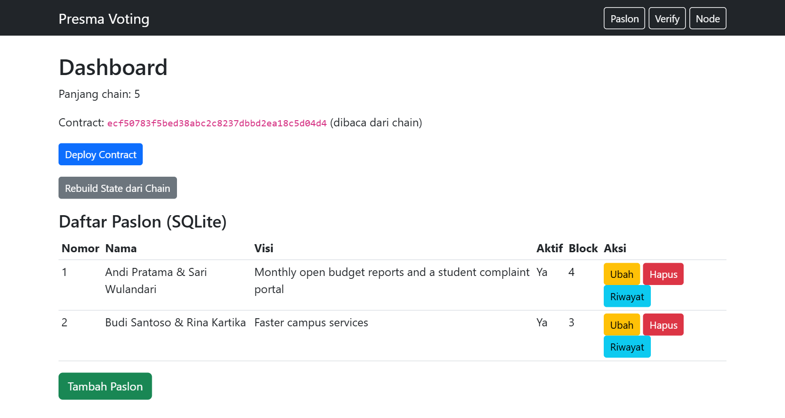
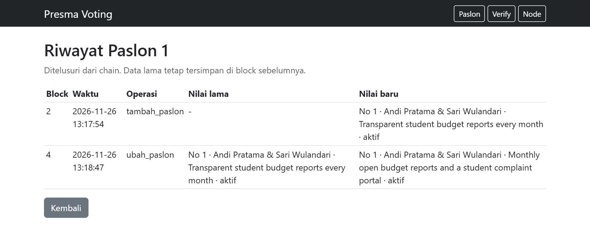
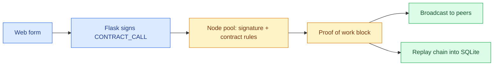

# Presma Voting Blockchain

A from-scratch Python blockchain for a student-president (Presma) election prototype at Universitas Tadulako: every vote and every candidate change is a signed transaction, mined with proof of work, shared across nodes, and shown in a Flask web app.




> [!WARNING]
> This is a course prototype. Do not use it for a real election: it does not verify student identity against university records, votes are not secret, and the chain lives in memory.

## 📌 Overview

A student election needs results that nobody can quietly change afterwards. This project records each action as a transaction signed with the sender's RSA key, packs transactions into blocks with proof of work, and copies the chain to every node. Any edit to an old block breaks its hash and is reported with the index of the first broken block.

The web app reads data from SQLite for speed, but SQLite is only an index: it can be wiped and rebuilt from the chain at any time, never the other way round.

Built for the **Teknologi Blockchain** course (S1 Teknik Informatika, Universitas Tadulako, 2026), covering two assignments:

| Assignment | Goal | Where it lives |
| --- | --- | --- |
| Project Based 1 | Distributed blockchain with signed transactions, pool, PoW, validation, and three or more nodes | `node.py`, `client.py` |
| Project Based 2 | Web CRUD app whose data is recorded on the chain, with a smart-contract mock-up enforcing the rules | `web/`, `contract.py` |

The user interface and console logs are in Indonesian. Words you will see: *Paslon* = candidate pair, *Tambah / Ubah / Hapus* = add / edit / delete, *Riwayat* = history, *Rantai* = chain, *Ditolak / Diterima* = rejected / accepted.

## ✨ Features

| Area | What it does |
| --- | --- |
| Blocks | `index`, `timestamp`, transactions, `previous_hash`, `nonce`, `hash` (SHA-256 over sorted JSON); fixed genesis block so every node starts identical |
| Signatures | RSA-2048 keys, RSA-PSS with SHA-256; a transaction edited after signing is rejected with the reason printed |
| Transaction pool | Transactions wait in a pool and are checked against the chain **and** the pool, so two conflicting transactions cannot enter the same block |
| Proof of work | Nonce search against a configurable difficulty; the log shows attempts, nonce, hash, and mining time |
| Network | Nodes broadcast transactions and blocks, follow the longest valid chain, reject invalid blocks with HTTP 409, and auto-discover each other on the LAN over UDP |
| Mining race | Mining runs outside the chain lock; if a peer finds the block first, local mining stops and the peer's block is kept |
| Smart contract mock-up | `PaslonContract` with `tambah_paslon`, `ubah_paslon`, `hapus_paslon` (state changes) and `daftar_paslon`, `baca_paslon` (reads). Deploy is itself an on-chain transaction, and only the deployer can change state |
| Web CRUD | Create, read, update, and soft-delete candidate pairs; each row shows the block that recorded it; history page shows old and new values |
| Integrity tools | Verify the whole chain from the browser, rebuild SQLite from the chain, and a demo tamper command to prove detection works |
| Hardening | Replay of old signed transactions blocked, one vote per normalized student ID (NIM), CSRF tokens on web forms, request size limit, peer address validation |

## 🚀 Quick start

Needs Python 3.9 or newer and Windows PowerShell (macOS/Linux: use `source .venv/bin/activate` and `export NODE_URL=...`).

1. Clone and install:

   ```powershell
   git clone https://github.com/DrBham/Blockchain---Voting-Presma.git
   cd Blockchain---Voting-Presma
   python -m venv .venv
   .\.venv\Scripts\Activate.ps1
   python -m pip install -r requirements.txt
   ```

2. Start two nodes, each in its own terminal (activate the virtual environment in each):

   ```powershell
   python node.py 5001 127.0.0.1:5002
   ```

   ```powershell
   python node.py 5002 127.0.0.1:5001
   ```

3. Start the web app in a third terminal (virtual environment activated):

   ```powershell
   $env:NODE_URL = "http://127.0.0.1:5001"
   python -m flask --app web.app run --port 5000
   ```

4. Open <http://127.0.0.1:5000>, click **Deploy Contract**, then **Tambah Paslon** to add a candidate pair.
5. Watch the node terminals: the transaction enters the pool, gets mined, and node 5002 receives the block.

> [!TIP]
> If PowerShell blocks `Activate.ps1`, run `Set-ExecutionPolicy -Scope Process Bypass` in that terminal first.

## 🧭 Usage

### Web app

| Page | Path | What you can show |
| --- | --- | --- |
| Dashboard | `/` | Chain length, active contract address read from the chain, candidate list with block numbers, **Rebuild State dari Chain** |
| Add / edit / delete | `/paslon/tambah`, `/paslon/<id>/ubah`, **Hapus** button | Each action becomes a signed `CONTRACT_CALL`; delete is a soft delete (`aktif = false`), the old blocks stay |
| History | `/paslon/<id>/riwayat` | Every change traced from the chain, with block, time, old value, and new value |
| Verify | `/chain/verify` | Valid chain, or the first broken block index and the reason |
| Node status | `/node/status` | Raw chain, peers, and vote tally from the connected node |



Rules the contract enforces (rejected requests produce no block):

- Candidate number is a whole number of at least 1 and unique among candidate pairs.
- Name is required (max 120 characters); vision is optional (max 500).
- Only active candidate pairs can be edited or deleted.

### Voting from the command line

`client.py` runs as a numbered menu when started without arguments, or as single commands:

```powershell
python client.py                                      # interactive menu with node auto-discovery
python client.py vote 127.0.0.1:5001 1 F55125001      # vote for candidate number 1
python client.py mine 127.0.0.1:5001                  # mine the pool into a block
python client.py tally 127.0.0.1:5001                 # count votes recorded on the chain
```

The first `vote` for a NIM creates its key pair in `dompet_<NIM>.pem` next to where you run the command. The private key never leaves that file.

<details>
<summary>All client commands</summary>

| Command | Purpose |
| --- | --- |
| `identitas <NIM>` | Create or load a voter key pair and print the address |
| `vote <node> <candidate_number> <NIM>` | Sign a vote and send it to the pool |
| `vote_ubah <node> <signed_number> <changed_number> <NIM>` | Change a vote after signing; the node must reject it |
| `pool <node>` | List pending transactions |
| `mine <node>` | Build a block from the pool and run proof of work |
| `chain <node>` | Print every block and transaction |
| `validate <node>` | Validate the whole chain |
| `tally <node>` | Count votes per candidate pair |
| `tamper <node> <index>` | Demo only: edit a transaction in an old block without rehashing |
| `add_peer <node> <peer>` | Connect two running nodes |
| `resolve <node>` | Apply the longest valid chain rule |
| `palsu <node>` | Send a block without valid proof of work; the node must reject it |

`<node>` is `host:port` without `http://`. A NIM is one capital letter and 7–8 digits, for example `F55125001`; the prototype accepts intake years 2023–2025.

</details>

### Running nodes

```text
python node.py                                 # interactive: pick network interface, free port, auto-discovery
python node.py <port> [peer1,peer2,...] [difficulty]
```

Difficulty is the number of leading zeros in the block hash (default `4`). All nodes must use the same difficulty. Each extra zero makes mining about 16 times slower: on the test laptop (about 70,000 hashes per second), `4` took about 1 second, so `5` averages around 15 seconds and `6` a few minutes.

Expected node output when a candidate pair is added from the web (trimmed):

```text
[5001] === TRANSAKSI MASUK ===
[5001] Signature VALID, transaksi sesuai aturan
[5001] Transaksi masuk pool. Transaksi pending sekarang: 1
[5001] === PROOF OF WORK (target: hash diawali 0000) ===
[5001] Percobaan nonce : 70238
[5001] Hash hasil      : 00008cf069564cba7bc4c82315383bd97d72743841394ec3bafa28f283e3b5e1
[5001] Lama menambang  : 1.013 detik
[5001] === BLOCK DITERIMA RANTAI ===
[5001] Pool sekarang    : 0 transaksi (kosong)
[5001]  -> block 2 dikirim ke 127.0.0.1:5002 (diterima)
```

### Node HTTP API

| Method | Path | Purpose |
| --- | --- | --- |
| GET | `/chain`, `/pool`, `/peers` | Current chain, pending transactions, peers |
| GET | `/validate` | Validate the whole chain |
| GET | `/tally` | Votes per candidate number |
| GET | `/resolve` | Apply the longest valid chain rule |
| GET | `/contract`, `/paslon` | Active contract address and owner, candidate state replayed from the chain |
| POST | `/transaksi` | Submit a signed transaction |
| POST | `/mine` | Mine the pool |
| POST | `/block` | Receive a block from a peer |
| POST | `/peers` | Add a peer (`host:port`) |
| POST | `/tamper` | Demo only, local machine only |

### Configuration

The web app reads these environment variables:

| Variable | Default | Purpose |
| --- | --- | --- |
| `NODE_URL` | `http://localhost:5001` | Node the web app sends transactions to |
| `AUTO_MINE` | `true` | Mine right after each web action |
| `DATABASE_URI` | `sqlite:///<repo>/web_state.db` | SQLite index of the current state |
| `ADMIN_WALLET_PATH` | `<repo>/dompet_admin.pem` | Key that signs contract deploys and calls |
| `CONTRACT_NAME` | `PaslonContract` | Name stored in the deploy transaction |
| `SECRET_KEY` | random at each start | Signs the session cookie that holds the CSRF token |

`flask run` listens on `127.0.0.1` only. The web app has no login, so keep it that way unless the network is trusted.

## ⚙️ How it works

A web action becomes a signed transaction, waits in the pool, is mined into a block, and only then appears in SQLite:



Every node checks each transaction with the same rules, whether it arrives in the pool, inside a peer's block, or during a full chain check:

| Transaction type | Accepted when |
| --- | --- |
| `VOTE` | Valid signature, valid NIM not seen before, candidate number of an active candidate pair |
| `CONTRACT_DEPLOY` | No contract deployed yet, 40-character hex address |
| `CONTRACT_CALL` | Sent by the deployer to the active contract, and the contract function accepts the arguments |

Every type also rejects a signature that is already on the chain, which stops replay of old transactions. A block is accepted only if its index follows the last block, `previous_hash` matches, the stored hash matches the content, the hash meets the difficulty, and every transaction passes the rules above.


## 🎯 Demo checkpoints

The assignments list checkpoints to show live. Project Based 2:

| # | Checkpoint | How to show it |
| --- | --- | --- |
| 1 | Two nodes, same genesis, web connected | Start both nodes; the `Genesis` line matches |
| 2 | Create from web | **Tambah Paslon**; node log shows pool, PoW, block accepted |
| 3 | Read | Dashboard lists candidate pairs with their block number |
| 4 | Update | **Ubah**, then **Riwayat** shows old and new values |
| 5 | Delete | **Hapus**; row shows `Tidak` (inactive), history keeps the record |
| 6 | Contract deployed and executed | **Deploy Contract**; node log prints `CONTRACT DEPLOYED` and `STATE CONTRACT BERUBAH` |
| 7 | Business rule enforced | Add a duplicate candidate number; the web shows the reason and no block is mined |
| 8 | Verify chain | **Verify** shows the chain is valid |
| 9 | Tamper an old block | `python client.py tamper 127.0.0.1:5001 2`, then **Verify** shows index 2 |
| 10 | Rebuild state | **Rebuild State dari Chain** restores the same list |
| 11 | Node sync | Stop node 5002, add data, restart it, run `python client.py resolve 127.0.0.1:5002` |
| 12 | Reject invalid block | `python client.py palsu 127.0.0.1:5001` returns HTTP 409 |

<details>
<summary>Project Based 1 checkpoints (command line)</summary>

| # | Checkpoint | Command |
| --- | --- | --- |
| 1 | Sender identity | `python client.py identitas F55125001` |
| 2–4 | Signed vote enters the pool | `python client.py vote 127.0.0.1:5001 1 F55125001`, then `pool` |
| 3 | Edited vote rejected | `python client.py vote_ubah 127.0.0.1:5001 1 2 F55125002` |
| 5–7 | Candidate block, PoW, block accepted | `python client.py mine 127.0.0.1:5001` |
| 8 | Valid chain | `python client.py validate 127.0.0.1:5001` |
| 9 | Tamper detection | `tamper 127.0.0.1:5001 1`, then `validate` |
| 10 | Broadcast and resolve | Node logs show send and receive; `resolve` on a restarted node |
| 11 | Invalid block rejected | `python client.py palsu 127.0.0.1:5001` |

A vote needs an active candidate pair, so add one from the web app first.

</details>

> [!NOTE]
> `tamper` only works from the same computer as the node, so nobody else on the network can corrupt it. A node whose own chain is broken takes the valid chain from a peer on the next `resolve`.

### Two laptops

1. Connect both laptops to the same network (a phone hotspot works best; campus Wi-Fi often blocks device-to-device traffic).
2. Run `ipconfig` on each laptop and note its IPv4 address.
3. Allow the node port (and UDP 9999 for discovery) through Windows Defender Firewall.
4. Laptop A: `python node.py 5001 <LAPTOP_B_IP>:5001`. Laptop B: `python node.py 5001 <LAPTOP_A_IP>:5001`.
5. Repeat checkpoints 11 and 12 across the laptops.

Running `python node.py` with no arguments on both laptops lets them find each other without typing addresses, if the network allows UDP broadcast.

## 🗂️ Project structure

```text
├── node.py              # Transactions, blocks, validation rules, node HTTP server, discovery
├── client.py            # Voter wallet and CLI (menu or single commands)
├── contract.py          # PaslonContract and chain replay into candidate state and history
├── web/
│   ├── app.py           # Flask app factory, CSRF check
│   ├── routes.py        # Pages; sends signed transactions to the node
│   ├── models.py        # SQLite table (index of the chain state)
│   └── templates/       # Bootstrap pages
├── tests/               # unittest suite
├── Dockerfile, docker-compose.yml
└── requirements.txt
```

## 🧪 Testing

```powershell
python -m unittest
```

```text
Ran 30 tests in 0.701s

OK
```

The suite covers contract rules and input edge cases, replay of the chain into state and history, transaction rules (owner-only calls, replay attack, double vote, wrong types), peer discovery, and mining cancellation.

<details>
<summary>Docker Compose (optional)</summary>

`docker compose up --build` starts three nodes reachable from the host at `127.0.0.1:5001`, `5002`, and `5003`. The containers run only the node; run `client.py` and the web app on the host. The `tamper` command is refused from the host because it is not the container's own machine.

</details>

## ⚠️ Limitations

- The chain is kept in memory. Restarting a node starts from genesis; it recovers only if a peer still has the chain.
- The NIM check covers format and intake year, not whether the student exists or owns the key.
- Votes are stored in plain text on the chain; there is no ballot secrecy.
- Private keys are unencrypted PEM files.
- The web app has no login; anyone who can open it can change candidate data.
- Difficulty is a fixed number of leading hex zeros, not adjusted to block time, and the longest-chain rule compares block count only.

## 👥 Team

Kelompok 4, S1 Teknik Informatika, Fakultas Teknik, Universitas Tadulako. Lecturer: Rizka Ardiansyah, S.Kom., M.Kom.

| Name | Role in the Project Based 1 report |
| --- | --- |
| Dimas Reginald Bhamakerti | Blockchain system and block structure design |
| Dimas Setiawan | Transactions and digital signatures |
| I Made Aditya Pramana | Blockchain testing and report writing |
| Moh Magribi Ramadhan | Proof of work and chain validation testing |
| Moh Fiqhi | Project documentation and test results |

## 📄 License

No license file yet, so all rights stay with the authors. Ask before reusing the code.
