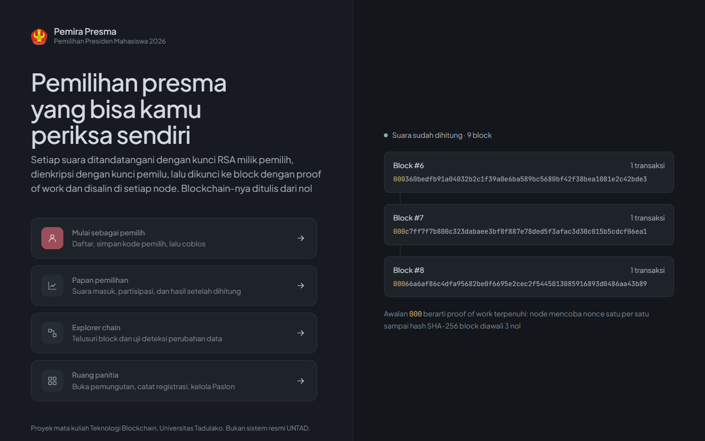
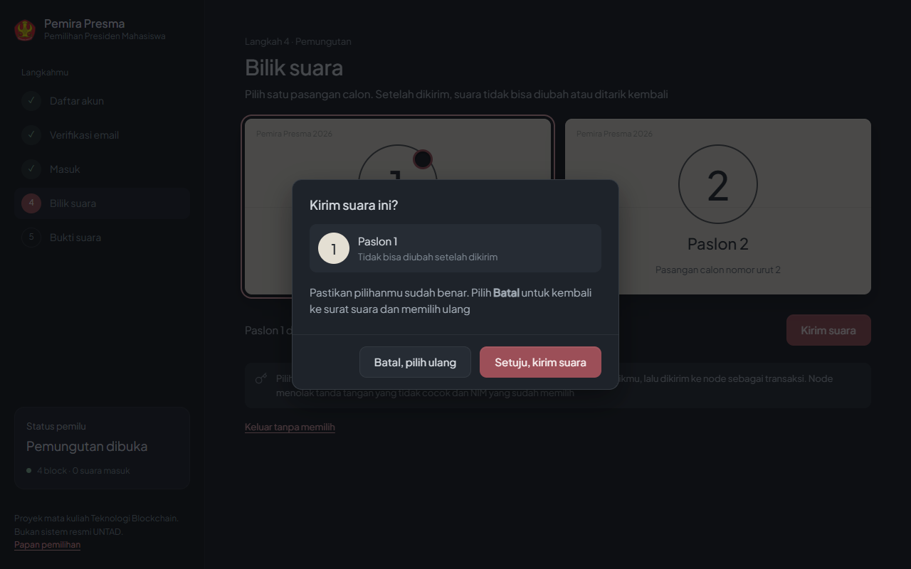
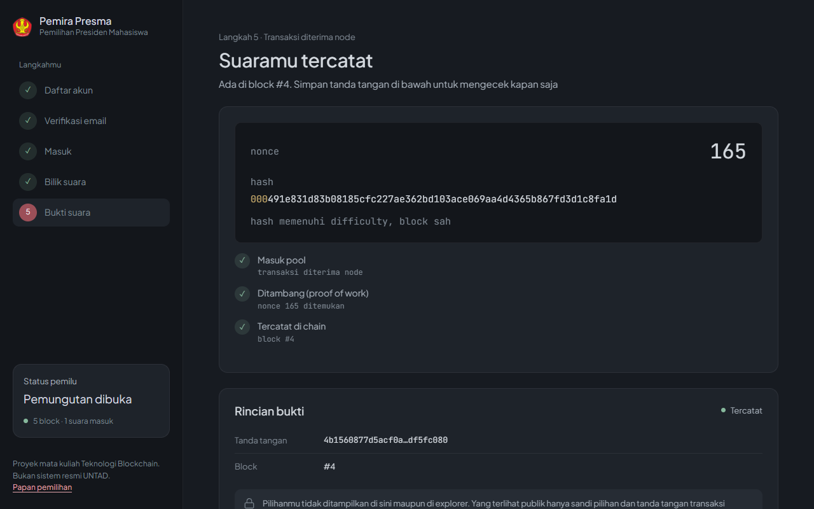
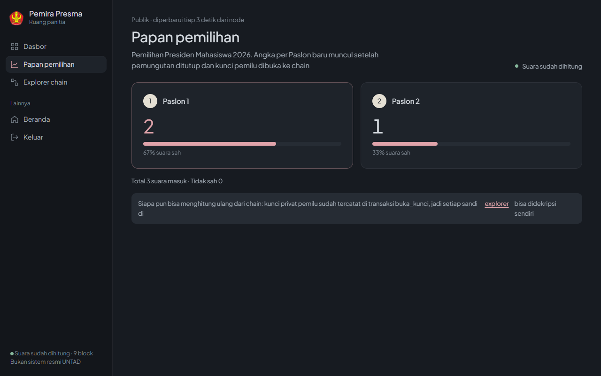
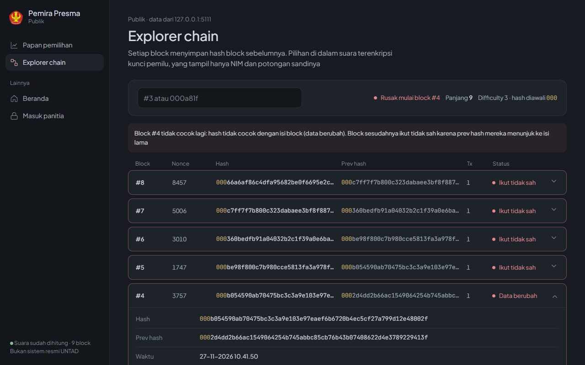
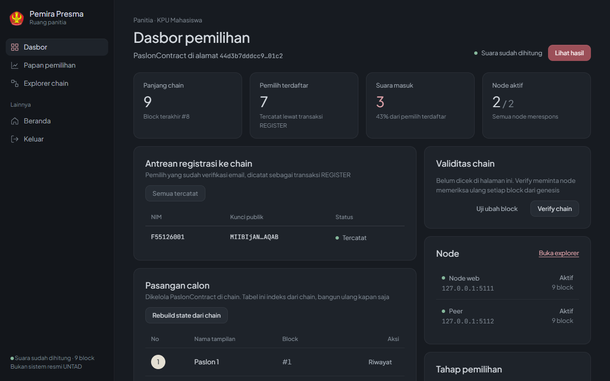
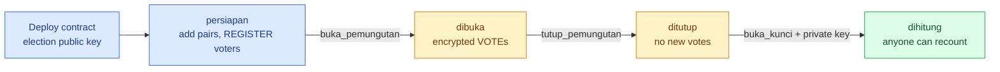

# Presma Voting Blockchain

A from-scratch Python blockchain for a student-president (Presma) election prototype at Universitas Tadulako: students register with their campus email, cast an encrypted and signed vote, and anyone can audit the chain and recount the result once the committee closes the vote.




> [!WARNING]
> This is a course prototype, not an official UNTAD system. Do not use it for a real election: it has no link to university student records, voter keys are held by the web server, and the chain lives in memory. See [Limitations](#limitations).

## 📌 Overview

A student election needs results that nobody can quietly change and a count that anyone can check. This project records every step of the election as a transaction signed with an RSA key: deploying the election contract, adding candidate pairs, registering voters, opening and closing the vote, and each ballot. Transactions are mined into blocks with proof of work and copied to every node. Editing an old block breaks its hash, and every node reports the first broken block.

Ballots are encrypted with an election key that only the committee holds. Totals per candidate stay hidden until the committee closes the vote and publishes that key on the chain; from then on anyone can recount from the raw chain.

Built for the **Teknologi Blockchain** course (S1 Teknik Informatika, Universitas Tadulako, 2026), covering two assignments:

| Assignment | Goal | Where it lives |
| --- | --- | --- |
| Project Based 1 | Distributed blockchain with signed transactions, pool, PoW, validation, and three or more nodes | `node.py`, `client.py` (menus in `menu_node.py`, `menu_client.py`) |
| Project Based 2 | Web CRUD app whose data is recorded on the chain, with a smart-contract mock-up enforcing the rules | `web/`, `contract.py` |

The user interface and console logs are in Indonesian. Words you will see:

| Term | Meaning |
| --- | --- |
| *Pemira*, *Presma* | Student general election, student president |
| *Paslon* | Candidate pair (shown only as "Paslon 1", "Paslon 2") |
| *Panitia* | Election committee (admin) |
| *Pemilih*, *NIM* | Voter, student ID number |
| *Daftar / Masuk / Keluar* | Register / sign in / sign out |
| *Bilik suara*, *Bukti* | Voting booth, vote receipt |
| *Papan pemilihan* | Public results board |
| *Tambah / Ubah / Hapus*, *Riwayat* | Add / edit / delete, history |
| *Diterima / Ditolak*, *Rantai* | Accepted / rejected, chain |

## ✨ Features

| Area | What it does |
| --- | --- |
| Blocks | `index`, `timestamp`, transactions, `previous_hash`, `nonce`, `hash` (SHA-256 over sorted JSON); fixed genesis block so every node starts identical |
| Signatures | RSA-2048 keys, RSA-PSS with SHA-256; a transaction edited after signing is rejected with the reason printed |
| Transaction types | `CONTRACT_DEPLOY`, `CONTRACT_CALL`, `REGISTER` (binds a NIM to one voter public key), `VOTE` (encrypted choice) |
| Secret ballot until counting | The choice is encrypted with RSA-OAEP (SHA-256) using the election public key from the deploy transaction; nodes check who voted, never what |
| Election contract | `PaslonContract` stores candidate pairs and the election status `persiapan → dibuka → ditutup → dihitung` (preparing, open, closed, counted); only the deployer can change it |
| Transaction pool | Transactions are checked against the chain **and** the pool, so two conflicting transactions cannot enter the same block |
| Proof of work | Nonce search against a configurable difficulty; the log shows attempts, nonce, hash, and mining time |
| Network | Nodes broadcast transactions and blocks, follow the longest valid chain, reject invalid blocks with HTTP 409, and find each other on the LAN over UDP port 9999 |
| Voter web flow | Register with NIM, confirm a 6-digit code sent to `NIM@untad.ac.id`, sign in, vote with a confirm step, and follow the receipt from pool to block |
| Committee web room | Deploy the contract, add / edit / deactivate candidate pairs with on-chain history, record voters to the chain, open, close and count the vote, verify the chain, rebuild state |
| Public pages | Live results board (per-pair numbers only after counting, withheld if the chain is invalid) and a chain explorer with a tamper demo for the committee |
| Hardening | One vote per registered NIM with the registered key only, replay of old signatures blocked, CSRF tokens, 5 MB request limit, peer address validation, tamper endpoint local-only |

## 🚀 Quick start

Needs Python 3.9 or newer (tested on 3.12) and Windows PowerShell. On macOS or Linux use `source .venv/bin/activate` and `export NODE_URL=...`.

1. Clone and install:

   ```powershell
   git clone https://github.com/DrBham/Blockchain---Voting-Presma.git
   cd Blockchain---Voting-Presma
   python -m venv .venv
   .\.venv\Scripts\Activate.ps1
   python -m pip install -r requirements.txt
   ```

2. Start two nodes, each in its own terminal with the virtual environment activated:

   ```powershell
   python menu_node.py 5001 127.0.0.1:5002
   ```

   ```powershell
   python menu_node.py 5002 127.0.0.1:5001
   ```

3. In a third terminal, seed the demo election: deploy the contract, add Paslon 1 and 2, and register six sample NIMs for the command-line client.

   ```powershell
   python seed_demo.py 127.0.0.1:5001
   ```

   ```text
     deploy contract: diterima
     tambah paslon 1: diterima
     tambah paslon 2: diterima
     REGISTER A12119001: diterima
     ...
   Tambang: block 1
   Status persiapan | terdaftar 6 | panjang chain 2
   ```

4. In the same terminal, start the web app:

   ```powershell
   $env:NODE_URL = "http://127.0.0.1:5001"
   python -m flask --app web.app run --port 5000
   ```

5. Open <http://127.0.0.1:5000>. The committee room is at <http://127.0.0.1:5000/panitia> with the local demo password `panitia-demo`.

> [!TIP]
> If PowerShell blocks `Activate.ps1`, run `Set-ExecutionPolicy -Scope Process Bypass` in that terminal first. To receive voter codes in a real inbox, run `docker compose up -d mailpit` and open <http://localhost:8025>; without Mailpit the web terminal prints each code.

`seed_demo.py` writes `kunci_pemilu.pem` (election private key), `dompet_admin.pem` (committee key) and `dompet_<NIM>.pem` (sample voter wallets, password `demo123`) into the repo folder. All of them are ignored by Git. It does not open the vote; the committee does that from the web.

## 🎮 Try it

Start from the Quick start state: two nodes, seeded chain, web app on port 5000.

### Scenario 1: Vote as a student

1. Open <http://127.0.0.1:5000> and click **Mulai sebagai pemilih**. Enter a NIM such as `F55126001` (one faculty letter and 7 or 8 digits), a password of at least 8 characters twice, and click **Daftar dan buat dompet**.
   ✅ **Email kampus** fills itself as `F55126001@untad.ac.id` and the page **Cek email kampusmu** asks for a 6-digit code.
2. Get the code from Mailpit (<http://localhost:8025>) or from the web terminal:

   ```text
   [EMAIL GAGAL] SMTP localhost:1025 (...). Kode pemilih untuk F55126001@untad.ac.id: 063649
   ```

   Type it into the six **Kode pemilih** boxes.
   ✅ The page moves to **Masuk ke bilik suara** with the message *Akun aktif*. Keep the code: you need it again to sign in.
3. In a new tab open <http://127.0.0.1:5000/panitia>, enter `panitia-demo`, and click **Catat 1 ke chain** in **Antrean registrasi ke chain**.
   ✅ *1 registrasi dicatat ke chain*; the NIM row shows **Tercatat**. The node logs a `REGISTER NIM F55126001` transaction in a new block.
4. Click **Buka pemungutan** and confirm.
   ✅ The status tag changes to **Pemungutan dibuka**. Candidate pairs can no longer change.
5. Back on **Masuk ke bilik suara**, enter the NIM, password and code, then click **Masuk dan buka bilik**.
   ✅ **Bilik suara** shows the ballots for Paslon 1 and Paslon 2.
6. Click a ballot, click **Kirim suara**, then **Setuju, kirim suara** (or **Batal, pilih ulang** to go back).
   ✅ **Suaramu tercatat** shows the block number, nonce, hash and your signature. The explorer shows your NIM and a piece of the ciphertext, never your choice.





A wrong code counts down (*Sisa 4 percobaan*); after 5 wrong tries the code is void and **Kirim ulang kode** sends a new one, at most once every 60 seconds. A NIM that registered but did not confirm stays locked for 15 minutes before it can register again.

<details>
<summary>Scenario 2: Close the vote and count it</summary>

1. Before closing, run `python menu_client.py tally 127.0.0.1:5001`.
   ✅ `Perolehan per paslon masih rahasia: suara terenkripsi sampai kunci pemilu dibuka (status dihitung).` The board at **/papan** shows only the number of votes received.
2. In the committee room click **Tutup pemungutan** and confirm.
   ✅ Pending votes are mined first, then the status becomes **Pemungutan ditutup** and new votes are refused.
3. Click **Buka kunci dan hitung** and confirm.
   ✅ *Kunci pemilu dibuka, hasil bisa dilihat di papan pemilihan*. The web app sends a `buka_kunci` call carrying `kunci_pemilu.pem`; the contract accepts it only if it matches the public key from the deploy.
4. Click **Lihat hasil**.
   ✅ **Papan pemilihan** shows votes per pair, the share of valid votes, and *Tidak sah* (ciphertexts that do not decrypt to an active pair).



</details>

<details>
<summary>Scenario 3: Tamper with a block, then repair it</summary>

The explorer's tamper button works only when the web app talks to a node on the same machine (the Quick start setup). With Docker nodes, use the command line instead ([Option A, step 10](#option-a-one-computer-three-docker-nodes)).

1. Signed in as committee, open **Explorer chain**, expand a block that holds a vote, and click **Uji: ubah isi block ini**.
   ✅ The header shows **Rusak mulai block #N**; that block is marked **Data berubah** and every later block **Ikut tidak sah**, because their previous hashes point to the old content.
2. Open **/papan** after counting.
   ✅ *Rantai di node ini tidak valid mulai block #N. Hasil ditahan sampai rantai dipulihkan dari node lain*.
3. Run `python menu_client.py validate 127.0.0.1:5002`.
   ✅ `Rantai VALID` on the other node: only node 5001 was changed.
4. Run `python menu_client.py resolve 127.0.0.1:5001`.
   ✅ `Rantai diganti`; the explorer shows the chain valid again. The background sync never replaces a broken chain by itself, so the broken state stays visible until you run `resolve`.



</details>

<details>
<summary>Scenario 4: Manage candidate pairs (before opening the vote)</summary>

The contract accepts candidate changes only while the status is **Belum dibuka** (preparing). Use a freshly seeded chain (see [Reset](#reset)).

1. In the committee dashboard, fill **Nomor urut** `3` and **Nama tampilan** `Paslon 3`, then click **Tambah paslon**.
   ✅ *Paslon 3 ditambahkan di block #2*.
2. Add another pair with **Nomor urut** `1`.
   ✅ *Ditolak: nomor paslon 1 sudah dipakai paslon aktif. Tidak ada block baru*.
3. Click **Ubah** on Paslon 3, change **Visi**, and click **Simpan**; then click **Riwayat**.
   ✅ The history page lists each change with its block, time, and *Sebelum* / *Sesudah* values.
4. Click **Hapus** on Paslon 3 and confirm.
   ✅ *Paslon dinonaktifkan di block #4, riwayatnya tetap di chain*; the pair moves to the **Nonaktif** list.
5. Click **Verify chain**, then **Rebuild state dari chain**.
   ✅ *5 block valid*, then *State dibangun ulang dari chain: 3 Paslon*.



</details>

### Troubleshooting

| Symptom | Fix |
| --- | --- |
| *Node tidak terjangkau* in the web app | Start a node and check `NODE_URL` points to it |
| *Akun belum dicatat panitia ke chain* in the booth | The committee must click **Catat ... ke chain** first |
| *Pemungutan suara belum dibuka panitia* | The committee must click **Buka pemungutan** |
| No email arrives | Start Mailpit, or copy the code from the web terminal line `Kode pemilih untuk ...` |
| `kunci pemilu di chain bukan pasangan kunci_pemilu.pem lokal` from the seed | The nodes still hold a chain from another key file; restart the nodes and seed again |

### Reset

The chain lives in node memory. Stop every node and the web app, delete `web_state.db` (voter accounts and the candidate index), start the nodes again, and rerun `seed_demo.py`.

## 🧭 Usage

### Web pages

| Page | Path | Who | What it shows |
| --- | --- | --- | --- |
| Home | `/` | Everyone | Entry points and the three latest blocks |
| Register, confirm, sign in | `/daftar`, `/verifikasi`, `/masuk` | Voters | Account with an RSA wallet encrypted by the voter's password; 6-digit voter code |
| Booth, receipt | `/bilik`, `/bukti` | Signed-in voter | Ballot with a confirm step; receipt that follows the transaction from pool to block |
| Results board | `/papan` | Everyone | Votes received and votes per hour; per-pair totals after counting; refreshes every 3 seconds |
| Chain explorer | `/explorer` | Everyone (tamper: committee) | Latest 50 blocks, search by `#index` or hash prefix, validity of the chain |
| Committee room | `/panitia` | Committee | Election stage, registration queue, candidate pairs, chain validity, node health |
| Pair history | `/panitia/paslon/<id>/riwayat` | Committee | Every change to one pair, replayed from the chain |

Rules the contract enforces (a rejected request creates no block):

- Candidate number is a whole number of at least 1 and unique among active pairs; name is required (max 120 characters), vision is optional (max 500).
- Pairs change only while the status is preparing; opening the vote needs at least two active pairs numbered 1, 2, ... without gaps.
- Registration is allowed while preparing or open; one key per NIM and one NIM per key.
- A vote is accepted only while the vote is open, from a registered NIM, signed by that NIM's registered key, once.

### Voting from the command line

`menu_client.py` runs as a numbered menu when started without arguments, or as single commands. Every command that opens a wallet asks for its password (`demo123` for the seeded NIMs).

```powershell
python menu_client.py                                      # interactive menu with node auto-discovery
python menu_client.py vote 127.0.0.1:5001 1 A12119001      # encrypted vote for candidate number 1
python menu_client.py mine 127.0.0.1:5001                  # mine the pool into a block
python menu_client.py tally 127.0.0.1:5001                 # votes received; per pair after counting
```

Only NIMs registered on the chain can vote. `seed_demo.py` registers `A12119001`, `A12119002`, `C30119001`, `C30119002`, `F55119001`, and `F55119002`; students who sign up on the web get their own key, registered by the committee.

<details>
<summary>All client commands</summary>

| Command | Purpose |
| --- | --- |
| `identitas <NIM>` | Create or open a password-protected wallet `dompet_<NIM>.pem` and print the address |
| `vote <node> <candidate_number> <NIM>` | Encrypt the choice with the election key, sign, and send to the pool |
| `vote_ubah <node> <signed_number> <changed_number> <NIM>` | Change the ciphertext after signing; the node must reject it |
| `pool <node>` | List pending transactions |
| `mine <node>` | Build a block from the pool and run proof of work |
| `chain <node>` | Print every block and transaction |
| `validate <node>` | Validate the whole chain |
| `tally <node>` | Votes received; per pair once the status is counted |
| `tamper <node> <index>` | Demo only: edit a transaction in an old block without rehashing (same machine as the node) |
| `add_peer <node> <peer>` | Connect two running nodes |
| `resolve <node>` | Apply the longest valid chain rule; also repairs a broken local chain |
| `palsu <node>` | Send a block without valid proof of work; the node must reject it |

`<node>` is `host:port` without `http://`. A NIM is one faculty letter (`A B C D E F G K L N P`) and 7 or 8 digits, for example `F55125001`. Every intake year may vote; the semester 3–7 rule in Untad Rector Regulation No. 1/2021 applies to candidates, not voters.

</details>

### Running nodes

```text
python menu_node.py                                 # interactive: pick network interface, free port, auto-discovery
python menu_node.py <port> [peer1,peer2,...] [difficulty]
```

Difficulty is the number of leading zeros in the block hash (default `4`). All nodes must use the same difficulty, or they reject each other's blocks. Each extra zero makes mining about 16 times slower: on the test laptop (about 70,000 hashes per second), `4` took about 1 second, so `5` averages around 15 seconds and `6` a few minutes.

Node output when a voter sends a vote from the web (trimmed, difficulty 3):

```text
[5111] === TRANSAKSI MASUK ===
[5111] Pengirim : F55126002 (alamat 77838d2c7288...)
[5111] Isi      : pilihan terenkripsi (sandi 2a634e60a2b438ed...)
[5111] Signature VALID, transaksi sesuai aturan
[5111] === PROOF OF WORK (target: hash diawali 000) ===
[5111] Nonce ditemukan : 165
[5111] Hash hasil      : 000491e831d83b08185cfc227ae362bd103ace069aa4d4365b867fd3d1c8fa1d
[5111] === BLOCK DITERIMA RANTAI ===
[5111] Pool sekarang    : 0 transaksi (kosong)
[5111]  -> block 4 dikirim ke 127.0.0.1:5112 (diterima)
```

### Node HTTP API

| Method | Path | Purpose |
| --- | --- | --- |
| GET | `/chain`, `/pool`, `/peers` | Current chain, pending transactions, peers |
| GET | `/status` | Election status, registered voters, votes received, chain length, last block, election public key, contract address |
| GET | `/pemilih/<nim>` | Whether a NIM is registered and has voted (pool included) |
| GET | `/tx/<signature>` | Whether a transaction is in the pool or in which block |
| GET | `/validate` | Validate the whole chain |
| GET | `/tally` | Votes received; per pair, invalid, and per block after counting |
| GET | `/resolve` | Apply the longest valid chain rule |
| GET | `/contract`, `/paslon` | Active contract address and owner, candidate pairs replayed from the chain |
| POST | `/transaksi` | Submit a signed transaction |
| POST | `/mine` | Mine the pool |
| POST | `/block` | Receive a block from a peer |
| POST | `/peers` | Add a peer (`host:port`) |
| POST | `/tamper` | Demo only, accepted only from the node's own machine |

### Configuration

The web app reads these environment variables. `seed_demo.py` reads the two key paths too, so set them the same way for both.

| Variable | Default | Purpose |
| --- | --- | --- |
| `NODE_URL` | `http://localhost:5001` | Node the web app talks to |
| `AUTO_MINE` | `true` | Mine right after each web transaction |
| `PANITIA_PASSWORD` | `panitia-demo` | Committee room password; change it whenever others can reach the app |
| `SECRET_KEY` | random at each start | Signs the session cookie; a restart signs everyone out |
| `MAIL_HOST`, `MAIL_PORT` | `localhost`, `1025` | SMTP server for voter codes (Mailpit) |
| `MAIL_FROM` | `pemira@untad.ac.id` | Sender of the code email |
| `KUNCI_PEMILU_PATH` | `<repo>/kunci_pemilu.pem` | Election private key, created at deploy and published only when counting |
| `ADMIN_WALLET_PATH` | `<repo>/dompet_admin.pem` | Committee key that signs deploy, contract calls, and `REGISTER` |
| `DATABASE_URI` | `sqlite:///<repo>/web_state.db` | Voter accounts and the candidate index |
| `CONTRACT_NAME` | `PaslonContract` | Name stored in the deploy transaction |

`flask run` listens on `127.0.0.1` only. Add `--host 0.0.0.0` only when other laptops must open the web app, and set `PANITIA_PASSWORD` first.

### Design mockup

`docs/mockup/` holds the static HTML mockup the web app was built from (home, register, code check, sign in, booth, receipt, explorer, committee room). Open `docs/mockup/index.html` in a browser; it needs no server.

## ⚙️ How it works

An election moves through four contract states. Each arrow is a signed transaction mined into a block:



Every node checks each transaction with the same rules, whether it arrives in the pool, inside a peer's block, or during a full chain check:

| Transaction type | Accepted when |
| --- | --- |
| `CONTRACT_DEPLOY` | No contract yet, 40-character hex address, election public key is RSA-2048 |
| `CONTRACT_CALL` | Sent by the deployer to the active contract, and the contract function accepts the arguments in the current status |
| `REGISTER` | Sent by the deployer while preparing or open; valid NIM not yet registered; RSA public key not used by another NIM |
| `VOTE` | Vote open; NIM registered and signed with its registered key; no plaintext choice; ciphertext is 512 hex characters; first vote of that NIM |

Every type also rejects a signature already on the chain, which stops replay of old transactions. A block is accepted only if its index follows the last block, `previous_hash` matches, the stored hash matches the content, the hash meets the difficulty, and every transaction passes the rules above.

On the web side, voter keys are created by the server, encrypted with the voter's password, and stored in SQLite. Signing in unlocks the key into server memory for at most 15 minutes; the cookie carries only a random token. The candidate table in SQLite is an index that **Rebuild state dari chain** can recreate from the chain at any time.

## 🎯 Demo checkpoints

The assignments list checkpoints to show live. Project Based 2 runs from the web app. First start two nodes and run `seed_demo.py` (or click **Deploy contract** on an empty chain), start the web app, and sign in at `/panitia` with `PANITIA_PASSWORD` (default `panitia-demo`). Checkpoints 2 to 7 need the status **Belum dibuka**.

| # | Checkpoint | How to show it |
| --- | --- | --- |
| 1 | Two nodes, same genesis, web connected | Both node terminals print the same `Genesis` line; the dashboard **Node** card lists both as **Aktif** |
| 2 | Create from web | **Tambah paslon**; node log shows the transaction, pool, PoW, and `BLOCK DITERIMA RANTAI` |
| 3 | Read | **Pasangan calon** lists each pair with the block that recorded it |
| 4 | Update | **Ubah**, then **Riwayat** shows old and new values per block |
| 5 | Delete | **Hapus**; the pair moves to **Nonaktif** and its history stays on the chain |
| 6 | Contract deployed and executed | Seed or **Deploy contract**; node log prints `CONTRACT DEPLOYED` and `STATE CONTRACT BERUBAH` |
| 7 | Business rule enforced | Add a pair with a number already in use; the web shows the reason and no block is mined |
| 8 | Verify chain | **Verify chain** shows the number of valid blocks |
| 9 | Tamper an old block | **Explorer chain** → **Uji: ubah isi block ini** (or `python menu_client.py tamper 127.0.0.1:5001 2`); the explorer and **Verify chain** name the first broken block |
| 10 | Rebuild state | **Rebuild state dari chain** restores the same list |
| 11 | Node sync and repair | `python menu_client.py resolve 127.0.0.1:5001` replaces the broken chain with the valid one from node 5002; a node that was offline catches up the same way |
| 12 | Reject invalid block | `python menu_client.py palsu 127.0.0.1:5001` returns HTTP 409 |

Project Based 1 checkpoints run from the command line: see the [CLI walkthrough](#cli-walkthrough).

<a id="cli-walkthrough"></a>

## 🖥️ CLI walkthrough

The Project Based 1 checkpoints run from the command line. Pick one setup:

- [Option A: one computer, three Docker nodes](#option-a-one-computer-three-docker-nodes)
- [Option B: two laptops, peer to peer](#option-b-two-laptops-peer-to-peer)

Both follow the same story: create an identity, vote, mine, check the chain, then break things on purpose and watch the network catch it.

> [!IMPORTANT]
> A vote needs a deployed contract, a NIM registered on the chain, and an open vote. Run `seed_demo.py` once, then click **Buka pemungutan** in the committee room, before voting. Each command that opens a seeded wallet asks for its password: type `demo123`.

### Option A: one computer, three Docker nodes

Needs Docker Desktop (running) and the Quick start step 1 install for the client and web app. Containers listen on port 5000 inside and are published on the host as `127.0.0.1:5001`, `5002`, and `5003`. The same command also starts Mailpit (SMTP `1025`, inbox <http://localhost:8025>).

**1. Start the network**

```powershell
docker compose up --build -d
docker compose logs -f node1 node2 node3
```

Keep the log terminal open: every checkpoint below prints there. Open a second terminal in the repo folder with the virtual environment activated.

**2. Seed the election and open the vote**

```powershell
python seed_demo.py 127.0.0.1:5001
$env:NODE_URL = "http://127.0.0.1:5001"
python -m flask --app web.app run --port 5000
```

The seed mines block 1. Open <http://127.0.0.1:5000/panitia>, sign in with `panitia-demo`, and click **Buka pemungutan** (block 2). Leave the web app running and open a third terminal (virtual environment activated) for the client.

**3. Checkpoint 1: create a voter identity**

```powershell
python menu_client.py identitas F55125001
```

```text
Password dompet F55125001:
Identitas voter F55125001 (dibuat)
  Alamat     : 6ab8f27040d6184ca00b3a148b175bcc5f6cb99f
  Public key : MIIBIjANBgkqhkiG9w0BAQEFAAOCAQ8AMIIBCgKC...
  Private key: disimpan lokal di 'dompet_F55125001.pem' (tidak dikirim ke node)
```

The wallet file is encrypted with the password you type. This new NIM is not registered on the chain, so the next steps vote with the seeded NIMs.

**4. Checkpoints 2 to 4: signed votes, rejected votes, and the pool**

```powershell
python menu_client.py vote 127.0.0.1:5001 1 A12119001
python menu_client.py vote_ubah 127.0.0.1:5001 1 2 A12119002
python menu_client.py vote 127.0.0.1:5002 2 A12119001
python menu_client.py vote 127.0.0.1:5001 1 F55125001
python menu_client.py pool 127.0.0.1:5003
```

Expected output, trimmed to the result lines:

```text
Transaksi DITERIMA node: transaksi diterima ke pool (pending di pool: 1)
Transaksi DITOLAK node (HTTP 400): signature tidak cocok (isi transaksi diubah setelah ditandatangani atau kunci salah)
Transaksi DITOLAK node (HTTP 400): NIM 'A12119001' sudah menggunakan hak pilihnya!
Transaksi DITOLAK node (HTTP 400): NIM 'F55125001' belum terdaftar sebagai pemilih
Transaksi pending di 127.0.0.1:5003: 1
  - A12119001: pilihan terenkripsi (sandi 430fd4f5eef032e1...) | sig 5faa4fddc3b4b767...
```

`vote_ubah` swaps the ciphertext after signing, so the signature no longer matches. The second vote from `A12119001` is refused even though it went to a different node, and the unregistered NIM is refused. The pool on node 3 already holds the vote because node 1 broadcast it.

**5. Checkpoints 5 to 7: build a block, run proof of work, add it to the chain**

```powershell
python menu_client.py mine 127.0.0.1:5001
```

```text
block berhasil ditambang dan ditambahkan: Block 3 (nonce <nonce>, hash 0000<rest of hash>...)
```

The nonce and hash differ on every run. The log terminal shows `BLOCK CANDIDATE` with the transactions and previous hash, then the nonce attempts, hash, and mining time, then `BLOCK DITERIMA RANTAI` with the pool back to 0.

**6. Checkpoint 8: every node has the same valid chain**

```powershell
python menu_client.py chain 127.0.0.1:5003
python menu_client.py validate 127.0.0.1:5002
python menu_client.py tally 127.0.0.1:5003
```

```text
Rantai VALID untuk seluruh 4 block
Status pemilu    : dibuka
Total Suara Masuk: 1
Perolehan per paslon masih rahasia: suara terenkripsi sampai kunci pemilu dibuka (status dihitung).
```

**7. Checkpoint 10: a node that was down catches up**

```powershell
docker compose stop node3
python menu_client.py vote 127.0.0.1:5001 2 C30119001
python menu_client.py mine 127.0.0.1:5001
docker compose start node3
python menu_client.py chain 127.0.0.1:5003
```

Node 3 restarts from the genesis block, asks its peers at startup, and logs `RESOLVE: rantai diganti dengan rantai terpanjang (5 block)`. `python menu_client.py resolve 127.0.0.1:5003` triggers the same check by hand and answers `Rantai tidak berubah` once the node has caught up.

**8. Checkpoint 11: a block without valid proof of work is rejected**

```powershell
python menu_client.py palsu 127.0.0.1:5001
```

```text
Block palsu DITOLAK oleh node. Status HTTP: 409
Alasan: proof of work tidak valid (hash tidak diawali 0000)
```

**9. Checkpoint 9: tamper with an old block, then repair it**

`tamper` only accepts requests from the node's own machine, so run it inside the container. The explorer button cannot reach Docker nodes for the same reason.

```powershell
docker compose exec node2 python menu_client.py tamper 127.0.0.1:5000 3
python menu_client.py validate 127.0.0.1:5002
python menu_client.py resolve 127.0.0.1:5002
python menu_client.py validate 127.0.0.1:5002
```

```text
data di block 3 diubah menjadi 'pilihan terenkripsi (sandi <first character flipped>...)'
Rantai TIDAK VALID. Block pertama yang rusak: index 3
Alasan: hash tidak cocok dengan isi block (data berubah)
Rantai diganti. Panjang sekarang: 5 block
Rantai VALID untuk seluruh 5 block
```

The broken chain stays broken until `resolve`: the background sync only follows longer chains and never repairs a tampered one by itself.

**10. Count the result and stop everything**

In the committee room click **Tutup pemungutan**, then **Buka kunci dan hitung**; `python menu_client.py tally 127.0.0.1:5003` now prints votes per pair. Press `Ctrl+C` in the web app and log terminals, then:

```powershell
docker compose down
```

The chain lives in memory, so the next `docker compose up` starts from genesis again. Delete `web_state.db` before seeding a new chain.

### Option B: two laptops, peer to peer

The same story across two machines without Docker. Replace `<LAPTOP_A_IP>` and `<LAPTOP_B_IP>` with the IPv4 addresses from `ipconfig`.

| Laptop | Runs | Address |
| --- | --- | --- |
| A (committee) | Node on port 5001, seed, web app, client | `<LAPTOP_A_IP>:5001`, web `<LAPTOP_A_IP>:5000` |
| B | Node on port 5002, client for `tamper` | `<LAPTOP_B_IP>:5002` |

**1. Prepare both laptops**

Do Quick start step 1 on both. Connect them to the same network; a phone hotspot is the most reliable, because campus Wi-Fi often blocks traffic between devices. Then check they can reach each other:

```powershell
ipconfig
ping <LAPTOP_B_IP>   # from Laptop A
ping <LAPTOP_A_IP>   # from Laptop B
```

**2. Open the firewall**

In PowerShell as Administrator, allow the node port on each laptop, UDP 9999 for discovery, and the web port on Laptop A:

```powershell
New-NetFirewallRule -DisplayName "Presma node 5001" -Direction Inbound -Protocol TCP -LocalPort 5001 -Action Allow   # Laptop A
New-NetFirewallRule -DisplayName "Presma web 5000" -Direction Inbound -Protocol TCP -LocalPort 5000 -Action Allow    # Laptop A
New-NetFirewallRule -DisplayName "Presma node 5002" -Direction Inbound -Protocol TCP -LocalPort 5002 -Action Allow   # Laptop B
New-NetFirewallRule -DisplayName "Presma discovery" -Direction Inbound -Protocol UDP -LocalPort 9999 -Action Allow   # both
```

If Windows asks whether Python may use the network, allow it on **Private** networks.

**3. Start one node on each laptop**

```powershell
python menu_node.py 5001 <LAPTOP_B_IP>:5002   # Laptop A
python menu_node.py 5002 <LAPTOP_A_IP>:5001   # Laptop B
```

Use the LAN address of the other laptop, never `127.0.0.1`. To change the difficulty, pass it as the third argument on **both** laptops (for example `... 5002 <LAPTOP_A_IP>:5001 3`). Both nodes print the same `Genesis` line. Confirm the ports are open:

```powershell
Test-NetConnection <LAPTOP_B_IP> -Port 5002   # from Laptop A, expect TcpTestSucceeded : True
Test-NetConnection <LAPTOP_A_IP> -Port 5001   # from Laptop B
```

**4. Seed once and start the web app on Laptop A**

```powershell
python seed_demo.py 127.0.0.1:5001
$env:NODE_URL = "http://127.0.0.1:5001"
$env:PANITIA_PASSWORD = "<choose-a-password>"
python -m flask --app web.app run --host 0.0.0.0 --port 5000
```

Run the seed on Laptop A only: it holds the committee key, the election key, and the sample wallets. Laptop B's log shows each block arriving with `DITERIMA dari peer`. Open <http://127.0.0.1:5000/panitia> on Laptop A and click **Buka pemungutan**. Students on the same network can register and vote at `http://<LAPTOP_A_IP>:5000`; without Mailpit, codes appear in Laptop A's web terminal.

**5. Run the checkpoints across the two nodes**

From a client terminal on Laptop A, where the seeded wallets live:

| Checkpoint | Command | What proves it |
| --- | --- | --- |
| 1 | `python menu_client.py identitas F55125001` | Address and wallet file printed |
| 2–3 | `python menu_client.py vote <LAPTOP_A_IP>:5001 1 A12119001` | Accepted; Laptop B's log shows the broadcast |
| 3 | `python menu_client.py vote_ubah <LAPTOP_A_IP>:5001 1 2 A12119002` | Rejected: signature does not match |
| 4 | `python menu_client.py pool <LAPTOP_B_IP>:5002` | Vote is pending on Laptop B too |
| 5–7 | `python menu_client.py mine <LAPTOP_A_IP>:5001` | Laptop A mines; Laptop B logs `block 3 DITERIMA dari peer` |
| 8 | `python menu_client.py validate <LAPTOP_B_IP>:5002` | `Rantai VALID` on Laptop B |
| 11 | `python menu_client.py palsu <LAPTOP_B_IP>:5002` | HTTP 409 from Laptop B |

**6. Checkpoint 10: Laptop B goes offline and catches up**

1. Press `Ctrl+C` on Laptop B's node.
2. On Laptop A: `python menu_client.py vote <LAPTOP_A_IP>:5001 2 C30119001`, then `python menu_client.py mine <LAPTOP_A_IP>:5001`.
3. On Laptop B: start the node again with the same command as step 3.
4. Run `python menu_client.py chain <LAPTOP_B_IP>:5002`. Laptop B fetched the longer chain from Laptop A at startup; `resolve` forces the same check.

**7. Checkpoint 9: tamper on Laptop B only**

Run on Laptop B, because `tamper` refuses requests from other machines (no wallet is needed):

```powershell
python menu_client.py tamper 127.0.0.1:5002 3
python menu_client.py validate 127.0.0.1:5002
python menu_client.py validate <LAPTOP_A_IP>:5001
python menu_client.py resolve 127.0.0.1:5002
```

Laptop B reports index 3 as broken while Laptop A stays valid. Laptop B stays broken until you run `resolve`, which replaces its chain with Laptop A's. To show the same check in the browser, tamper Laptop A's node from **Explorer chain** instead, then run `resolve` against Laptop A.

> [!TIP]
> Running `python menu_node.py` with no arguments on both laptops picks the network interface and a free port, then finds the other node over UDP port 9999. Use the node menu's manual peer option if the network blocks broadcast.

## 🗂️ Project structure

```text
├── node.py              # Transactions, blocks, validation rules, node HTTP server, discovery
├── client.py            # Password-encrypted voter wallet, signing, sending to a node
├── contract.py          # PaslonContract, election status, ballot encryption, chain replay
├── menu_node.py         # Runs a node: interface prompt, numbered menu (start here)
├── menu_client.py       # Voter CLI: numbered menu or single commands (start here)
├── seed_demo.py         # Deploy, Paslon 1 and 2, six registered sample NIMs
├── web/
│   ├── app.py           # Flask app factory, CSRF check, committee login guard
│   ├── pemilih.py       # Voter pages: register, code check, sign in, booth, receipt
│   ├── panitia.py       # Committee room: contract calls, REGISTER, open/close/count
│   ├── publik.py        # Home, results board, explorer, tamper demo
│   ├── node_api.py      # All HTTP calls from the web app to the node
│   ├── models.py        # SQLite: voter accounts and candidate index
│   ├── surel.py         # Sends the voter code over SMTP
│   ├── static/, templates/
├── docs/mockup/         # Static HTML design mockup
├── tests/               # unittest suite
├── Dockerfile, docker-compose.yml
└── requirements.txt
```

## 🧪 Testing

```powershell
python -m unittest discover -s tests
```

```text
Ran 75 tests in 7.827s

OK
```

The suite covers contract rules and status changes, ballot encryption and counting, transaction rules (registration, owner-only calls, replay, double vote, wrong key), chain replay into state and history, peer discovery, mining cancellation, and the voter and committee web flows.

<a id="limitations"></a>

## ⚠️ Limitations

- **No link to university records.** Proof of being a student is receiving a code at `NIM@untad.ac.id`. There is no voter roll (DPT) feed, so any NIM with a valid pattern and faculty letter can register.
- **Server-held voter keys.** The web app creates each voter's key and stores it encrypted with the voter's password. Whoever runs the server and learns a password can sign for that voter.
- **One election key, held by the committee.** The committee could decrypt ballots early with `kunci_pemilu.pem`, and losing the file makes counting impossible.
- **Secrecy ends at counting.** Counting publishes the election private key on the chain, and every `VOTE` carries its NIM, so afterwards anyone can decrypt how a given NIM voted from `/chain`. Proof of vote, and with it vote buying, stays possible.
- The chain is kept in memory. Restarting a node starts from genesis; it recovers only if a peer still has the chain.
- Difficulty is a fixed number of leading hex zeros, not adjusted to block time, and the longest-chain rule compares block count only.

## 👥 Team

Kelompok 4, S1 Teknik Informatika, Fakultas Teknik, Universitas Tadulako. Lecturer: Rizka Ardiansyah, S.Kom., M.Kom.

| Name | Role in the Project Based 1 report |
| --- | --- |
| Dimas Reginald Bhamakerti | Blockchain system and block structure design |
| Dimas Setiawan | Transactions and digital signatures |
| I Made Aditya Pramana | Blockchain testing and report writing |
| Moh Magribi Ramadhan | Proof of work and chain validation testing |
| Moh Fiqhi | Project documentation and test results |

## 📄 License

[MIT](LICENSE). Built as coursework for Teknologi Blockchain at Universitas Tadulako; anyone may study, reuse, and extend it.
