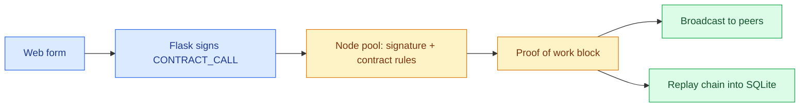
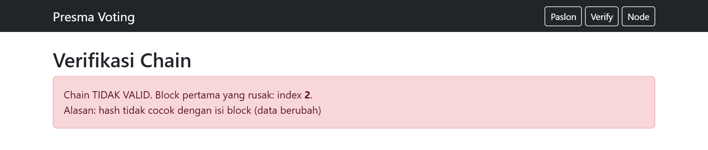

# Presma Voting Blockchain

A from-scratch Python blockchain for a student-president (Presma) election prototype at Universitas Tadulako: every vote and every candidate change is a signed transaction, mined with proof of work, shared across nodes, and shown in a Flask web app.


> [!WARNING]
> This is a course prototype. Do not use it for a real election: it does not verify student identity against university records, votes are not secret, and the chain lives in memory.

## 📌 Overview

A student election needs results that nobody can quietly change afterwards. This project records each action as a transaction signed with the sender's RSA key, packs transactions into blocks with proof of work, and copies the chain to every node. Any edit to an old block breaks its hash and is reported with the index of the first broken block.

The web app reads data from SQLite for speed, but SQLite is only an index: it can be wiped and rebuilt from the chain at any time, never the other way round.

Built for the **Teknologi Blockchain** course (S1 Teknik Informatika, Universitas Tadulako, 2026), covering two assignments:

| Assignment | Goal | Where it lives |
| --- | --- | --- |
| Project Based 1 | Distributed blockchain with signed transactions, pool, PoW, validation, and three or more nodes | `node.py`, `client.py` |
| Project Based 2 | Web CRUD app whose data is recorded on the chain, with a smart-contract mock-up enforcing the rules | `web/`, `contract.py` |

The user interface and console logs are in Indonesian. Words you will see: *Paslon* = candidate pair, *Tambah / Ubah / Hapus* = add / edit / delete, *Riwayat* = history, *Rantai* = chain, *Ditolak / Diterima* = rejected / accepted.

## ✨ Features

| Area | What it does |
| --- | --- |
| Blocks | `index`, `timestamp`, transactions, `previous_hash`, `nonce`, `hash` (SHA-256 over sorted JSON); fixed genesis block so every node starts identical |
| Signatures | RSA-2048 keys, RSA-PSS with SHA-256; a transaction edited after signing is rejected with the reason printed |
| Transaction pool | Transactions wait in a pool and are checked against the chain **and** the pool, so two conflicting transactions cannot enter the same block |
| Proof of work | Nonce search against a configurable difficulty; the log shows attempts, nonce, hash, and mining time |
| Network | Nodes broadcast transactions and blocks, follow the longest valid chain, reject invalid blocks with HTTP 409, and auto-discover each other on the LAN over UDP |
| Mining race | Mining runs outside the chain lock; if a peer finds the block first, local mining stops and the peer's block is kept |
| Smart contract mock-up | `PaslonContract` with `tambah_paslon`, `ubah_paslon`, `hapus_paslon` (state changes) and `daftar_paslon`, `baca_paslon` (reads). Deploy is itself an on-chain transaction, and only the deployer can change state |
| Web CRUD | Create, read, update, and soft-delete candidate pairs; each row shows the block that recorded it; history page shows old and new values |
| Integrity tools | Verify the whole chain from the browser, rebuild SQLite from the chain, and a demo tamper command to prove detection works |
| Hardening | Replay of old signed transactions blocked, one vote per normalized student ID (NIM), CSRF tokens on web forms, request size limit, peer address validation |

## 🚀 Quick start

Needs Python 3.9 or newer and Windows PowerShell (macOS/Linux: use `source .venv/bin/activate` and `export NODE_URL=...`).

1. Clone and install:

   ```powershell
   git clone https://github.com/DrBham/Blockchain---Voting-Presma.git
   cd Blockchain---Voting-Presma
   python -m venv .venv
   .\.venv\Scripts\Activate.ps1
   python -m pip install -r requirements.txt
   ```

2. Start two nodes, each in its own terminal (activate the virtual environment in each):

   ```powershell
   python node.py 5001 127.0.0.1:5002
   ```

   ```powershell
   python node.py 5002 127.0.0.1:5001
   ```

3. Start the web app in a third terminal (virtual environment activated):

   ```powershell
   $env:NODE_URL = "http://127.0.0.1:5001"
   python -m flask --app web.app run --port 5000
   ```

4. Open <http://127.0.0.1:5000>, click **Deploy Contract**, then **Tambah Paslon** to add a candidate pair.
5. Watch the node terminals: the transaction enters the pool, gets mined, and node 5002 receives the block.

> [!TIP]
> If PowerShell blocks `Activate.ps1`, run `Set-ExecutionPolicy -Scope Process Bypass` in that terminal first.

## 🧭 Usage

### Web app

| Page | Path | What you can show |
| --- | --- | --- |
| Dashboard | `/` | Chain length, active contract address read from the chain, candidate list with block numbers, **Rebuild State dari Chain** |
| Add / edit / delete | `/paslon/tambah`, `/paslon/<id>/ubah`, **Hapus** button | Each action becomes a signed `CONTRACT_CALL`; delete is a soft delete (`aktif = false`), the old blocks stay |
| History | `/paslon/<id>/riwayat` | Every change traced from the chain, with block, time, old value, and new value |
| Verify | `/chain/verify` | Valid chain, or the first broken block index and the reason |
| Node status | `/node/status` | Raw chain, peers, and vote tally from the connected node |


Rules the contract enforces (rejected requests produce no block):

- Candidate number is a whole number of at least 1 and unique among candidate pairs.
- Name is required (max 120 characters); vision is optional (max 500).
- Only active candidate pairs can be edited or deleted.

### Voting from the command line

`client.py` runs as a numbered menu when started without arguments, or as single commands:

```powershell
python client.py                                      # interactive menu with node auto-discovery
python client.py vote 127.0.0.1:5001 1 F55125001      # vote for candidate number 1
python client.py mine 127.0.0.1:5001                  # mine the pool into a block
python client.py tally 127.0.0.1:5001                 # count votes recorded on the chain
```

For a full run from identity to tamper detection, follow the [CLI walkthrough](#cli-walkthrough). The first `vote` for a NIM creates its key pair in `dompet_<NIM>.pem` next to where you run the command. The private key never leaves that file.

<details>
<summary>All client commands</summary>

| Command | Purpose |
| --- | --- |
| `identitas <NIM>` | Create or load a voter key pair and print the address |
| `vote <node> <candidate_number> <NIM>` | Sign a vote and send it to the pool |
| `vote_ubah <node> <signed_number> <changed_number> <NIM>` | Change a vote after signing; the node must reject it |
| `pool <node>` | List pending transactions |
| `mine <node>` | Build a block from the pool and run proof of work |
| `chain <node>` | Print every block and transaction |
| `validate <node>` | Validate the whole chain |
| `tally <node>` | Count votes per candidate pair |
| `tamper <node> <index>` | Demo only: edit a transaction in an old block without rehashing |
| `add_peer <node> <peer>` | Connect two running nodes |
| `resolve <node>` | Apply the longest valid chain rule |
| `palsu <node>` | Send a block without valid proof of work; the node must reject it |

`<node>` is `host:port` without `http://`. A NIM is one capital letter and 7–8 digits, for example `F55125001`; every intake year may vote. The semester 3–7 limit in Untad Rector Regulation No. 1/2021 applies to candidates, not voters.

</details>

### Running nodes

```text
python node.py                                 # interactive: pick network interface, free port, auto-discovery
python node.py <port> [peer1,peer2,...] [difficulty]
```

Difficulty is the number of leading zeros in the block hash (default `4`). All nodes must use the same difficulty. Each extra zero makes mining about 16 times slower: on the test laptop (about 70,000 hashes per second), `4` took about 1 second, so `5` averages around 15 seconds and `6` a few minutes.

Expected node output when a candidate pair is added from the web (trimmed):

```text
[5001] === TRANSAKSI MASUK ===
[5001] Signature VALID, transaksi sesuai aturan
[5001] Transaksi masuk pool. Transaksi pending sekarang: 1
[5001] === PROOF OF WORK (target: hash diawali 0000) ===
[5001] Percobaan nonce : 70238
[5001] Hash hasil      : 00008cf069564cba7bc4c82315383bd97d72743841394ec3bafa28f283e3b5e1
[5001] Lama menambang  : 1.013 detik
[5001] === BLOCK DITERIMA RANTAI ===
[5001] Pool sekarang    : 0 transaksi (kosong)
[5001]  -> block 2 dikirim ke 127.0.0.1:5002 (diterima)
```

### Node HTTP API

| Method | Path | Purpose |
| --- | --- | --- |
| GET | `/chain`, `/pool`, `/peers` | Current chain, pending transactions, peers |
| GET | `/validate` | Validate the whole chain |
| GET | `/tally` | Votes per candidate number |
| GET | `/resolve` | Apply the longest valid chain rule |
| GET | `/contract`, `/paslon` | Active contract address and owner, candidate state replayed from the chain |
| POST | `/transaksi` | Submit a signed transaction |
| POST | `/mine` | Mine the pool |
| POST | `/block` | Receive a block from a peer |
| POST | `/peers` | Add a peer (`host:port`) |
| POST | `/tamper` | Demo only, local machine only |

### Configuration

The web app reads these environment variables:

| Variable | Default | Purpose |
| --- | --- | --- |
| `NODE_URL` | `http://localhost:5001` | Node the web app sends transactions to |
| `AUTO_MINE` | `true` | Mine right after each web action |
| `DATABASE_URI` | `sqlite:///<repo>/web_state.db` | SQLite index of the current state |
| `ADMIN_WALLET_PATH` | `<repo>/dompet_admin.pem` | Key that signs contract deploys and calls |
| `CONTRACT_NAME` | `PaslonContract` | Name stored in the deploy transaction |
| `SECRET_KEY` | random at each start | Signs the session cookie that holds the CSRF token |

`flask run` listens on `127.0.0.1` only. The web app has no login, so keep it that way unless the network is trusted.

## ⚙️ How it works

A web action becomes a signed transaction, waits in the pool, is mined into a block, and only then appears in SQLite:



Every node checks each transaction with the same rules, whether it arrives in the pool, inside a peer's block, or during a full chain check:

| Transaction type | Accepted when |
| --- | --- |
| `VOTE` | Valid signature, valid NIM not seen before, candidate number of an active candidate pair |
| `CONTRACT_DEPLOY` | No contract deployed yet, 40-character hex address |
| `CONTRACT_CALL` | Sent by the deployer to the active contract, and the contract function accepts the arguments |

Every type also rejects a signature that is already on the chain, which stops replay of old transactions. A block is accepted only if its index follows the last block, `previous_hash` matches, the stored hash matches the content, the hash meets the difficulty, and every transaction passes the rules above.



## 🎯 Demo checkpoints

The assignments list checkpoints to show live. Project Based 2:

| # | Checkpoint | How to show it |
| --- | --- | --- |
| 1 | Two nodes, same genesis, web connected | Start both nodes; the `Genesis` line matches |
| 2 | Create from web | **Tambah Paslon**; node log shows pool, PoW, block accepted |
| 3 | Read | Dashboard lists candidate pairs with their block number |
| 4 | Update | **Ubah**, then **Riwayat** shows old and new values |
| 5 | Delete | **Hapus**; row shows `Tidak` (inactive), history keeps the record |
| 6 | Contract deployed and executed | **Deploy Contract**; node log prints `CONTRACT DEPLOYED` and `STATE CONTRACT BERUBAH` |
| 7 | Business rule enforced | Add a duplicate candidate number; the web shows the reason and no block is mined |
| 8 | Verify chain | **Verify** shows the chain is valid |
| 9 | Tamper an old block | `python client.py tamper 127.0.0.1:5001 2`, then **Verify** shows index 2 |
| 10 | Rebuild state | **Rebuild State dari Chain** restores the same list |
| 11 | Node sync | Stop node 5002, add data, restart it, run `python client.py resolve 127.0.0.1:5002` |
| 12 | Reject invalid block | `python client.py palsu 127.0.0.1:5001` returns HTTP 409 |

Project Based 1 checkpoints run from the command line: see the [CLI walkthrough](#cli-walkthrough).

<a id="cli-walkthrough"></a>

## 🖥️ CLI walkthrough

The Project Based 1 checkpoints run from the command line. Pick one setup:

- [Option A: one computer, three Docker nodes](#option-a-one-computer-three-docker-nodes)
- [Option B: two laptops, peer to peer](#option-b-two-laptops-peer-to-peer)

Both follow the same story: create an identity, vote, mine, check the chain, then break things on purpose and watch the network catch it.

> [!IMPORTANT]
> A vote is accepted only for an active candidate pair, and candidate pairs are created through the contract. Add them once from the web app (step 2 in each option) before voting.

### Option A: one computer, three Docker nodes

Needs Docker Desktop (running) and the Quick start step 1 install for the client and web app. Containers listen on port 5000 inside and are published on the host as `127.0.0.1:5001`, `5002`, and `5003`.

**1. Start the network**

```powershell
docker compose up --build -d
docker compose logs -f
```

Keep the log terminal open: every checkpoint below prints there. Open a second terminal in the repo folder with the virtual environment activated for the next steps.

**2. Deploy the contract and add two candidate pairs**

```powershell
$env:NODE_URL = "http://127.0.0.1:5001"
python -m flask --app web.app run --port 5000
```

Open <http://127.0.0.1:5000>, click **Deploy Contract**, then **Tambah Paslon** twice: number `1` and number `2`. That mines blocks 1 to 3. Leave the web app running and open a third terminal (virtual environment activated) for the client.

**3. Checkpoint 1: create a voter identity**

```powershell
python client.py identitas F55125001
```

```text
Identitas voter F55125001 (dibuat)
  Alamat     : 1278ab2f359d2926fb08cb34d1e8fe8cbe5f14f8
  Public key : MIIBIjANBgkqhkiG9w0BAQEFAAOCAQ8AMIIBCgKC...
  Private key: disimpan lokal di 'dompet_F55125001.pem' (tidak dikirim ke node)
```

**4. Checkpoints 2 to 4: signed votes, rejected votes, and the pool**

```powershell
python client.py vote 127.0.0.1:5001 1 F55125001
python client.py vote 127.0.0.1:5001 2 F55125002
python client.py vote_ubah 127.0.0.1:5001 1 2 F55125003
python client.py vote 127.0.0.1:5002 2 F55125001
python client.py pool 127.0.0.1:5003
```

Expected output, trimmed to the result lines:

```text
Transaksi DITERIMA node: transaksi diterima ke pool (pending di pool: 2)
Transaksi DITOLAK node (HTTP 400): signature tidak cocok (isi transaksi diubah setelah ditandatangani atau kunci salah)
Transaksi DITOLAK node (HTTP 400): NIM 'F55125001' sudah menggunakan hak pilihnya!
Transaksi pending di 127.0.0.1:5003: 2
  - F55125001: vote paslon 1 | sig 5e6f81229512fddb...
  - F55125002: vote paslon 2 | sig 6ea45acc092a8fa9...
```

`vote_ubah` changes the vote after signing, so the signature no longer matches. The second vote from `F55125001` is refused even though it went to a different node. The pool on node 3 already holds both votes because node 1 broadcast them.

**5. Checkpoints 5 to 7: build a block, run proof of work, add it to the chain**

```powershell
python client.py mine 127.0.0.1:5001
```

```text
block berhasil ditambang dan ditambahkan: Block 4 (nonce 27374, hash 0000a15374e4f5a5f036...)
```

The log terminal shows `BLOCK CANDIDATE` with the transactions and previous hash, then the nonce attempts, hash, and mining time, then `BLOCK DITERIMA RANTAI` with the pool back to 0.

**6. Checkpoints 8 and 10: every node has the same valid chain**

```powershell
python client.py chain 127.0.0.1:5003
python client.py validate 127.0.0.1:5002
python client.py tally 127.0.0.1:5003
```

```text
Rantai VALID untuk seluruh 5 block
Total Suara Masuk: 2
```

**7. Checkpoint 10: a node that was down catches up**

```powershell
docker compose stop node3
python client.py vote 127.0.0.1:5001 1 F55125004
python client.py mine 127.0.0.1:5001
docker compose start node3
python client.py chain 127.0.0.1:5003
```

Node 3 restarts from the genesis block, asks its peers at startup, and logs `RESOLVE: rantai diganti dengan rantai terpanjang (6 block)`. Run `python client.py resolve 127.0.0.1:5003` to trigger the same check by hand; it answers `Rantai tidak berubah` once the node has caught up.

**8. Checkpoint 11: a block without valid proof of work is rejected**

```powershell
python client.py palsu 127.0.0.1:5001
```

```text
Block palsu DITOLAK oleh node. Status HTTP: 409
Alasan: proof of work tidak valid (hash tidak diawali 0000)
```

**9. Checkpoint 9: tamper with an old block, then repair it**

`tamper` only accepts requests from the node's own machine, so run it inside the container:

```powershell
docker compose exec node2 python client.py tamper 127.0.0.1:5000 4
python client.py validate 127.0.0.1:5002
python client.py resolve 127.0.0.1:5002
python client.py validate 127.0.0.1:5002
```

```text
data di block 4 diubah menjadi 'vote paslon 2'
Rantai TIDAK VALID. Block pertama yang rusak: index 4
Alasan: hash tidak cocok dengan isi block (data berubah)
Rantai diganti. Panjang sekarang: 6 block
Rantai VALID untuk seluruh 6 block
```

**10. Stop everything**

Press `Ctrl+C` in the web app and log terminals, then:

```powershell
docker compose down
```

The chain lives in memory, so the next `docker compose up` starts from genesis again.

### Option B: two laptops, peer to peer

The same story across two machines. Replace `<LAPTOP_A_IP>` and `<LAPTOP_B_IP>` with the IPv4 addresses from `ipconfig`.

| Laptop | Runs | Node address |
| --- | --- | --- |
| A | Node on port 5001, web app, client | `<LAPTOP_A_IP>:5001` |
| B | Node on port 5002, client | `<LAPTOP_B_IP>:5002` |

**1. Prepare both laptops**

Do Quick start step 1 on both. Connect them to the same network; a phone hotspot is the most reliable, because campus Wi-Fi often blocks traffic between devices. Then check they can reach each other:

```powershell
ipconfig
ping <LAPTOP_B_IP>   # from Laptop A
ping <LAPTOP_A_IP>   # from Laptop B
```

**2. Open the node port in Windows Defender Firewall**

In PowerShell as Administrator:

```powershell
New-NetFirewallRule -DisplayName "Presma node 5001" -Direction Inbound -Protocol TCP -LocalPort 5001 -Action Allow   # Laptop A
New-NetFirewallRule -DisplayName "Presma node 5002" -Direction Inbound -Protocol TCP -LocalPort 5002 -Action Allow   # Laptop B
```

If Windows asks whether Python may use the network, allow it on **Private** networks.

**3. Start one node on each laptop**

```powershell
python node.py 5001 <LAPTOP_B_IP>:5002   # Laptop A
python node.py 5002 <LAPTOP_A_IP>:5001   # Laptop B
```

Use the LAN address of the other laptop, never `127.0.0.1`. Both nodes print the same `Genesis` line. Confirm the ports are open:

```powershell
Test-NetConnection <LAPTOP_B_IP> -Port 5002   # from Laptop A, expect TcpTestSucceeded : True
Test-NetConnection <LAPTOP_A_IP> -Port 5001   # from Laptop B
```

**4. Deploy the contract and add candidate pairs on Laptop A**

```powershell
$env:NODE_URL = "http://127.0.0.1:5001"
python -m flask --app web.app run --port 5000
```

In <http://127.0.0.1:5000>, click **Deploy Contract** and add candidate pairs `1` and `2`. Laptop B's node log shows each block arriving with `DITERIMA dari peer`.

**5. Run the checkpoints across the two nodes**

From a client terminal on either laptop:

| Checkpoint | Command | What proves it |
| --- | --- | --- |
| 1 | `python client.py identitas F55125001` | Address and key file printed |
| 2–3 | `python client.py vote <LAPTOP_A_IP>:5001 1 F55125001` | Accepted; Laptop B's log shows the broadcast |
| 3 | `python client.py vote_ubah <LAPTOP_A_IP>:5001 1 2 F55125002` | Rejected: signature does not match |
| 4 | `python client.py pool <LAPTOP_B_IP>:5002` | Vote is pending on Laptop B too |
| 5–7 | `python client.py mine <LAPTOP_A_IP>:5001` | Laptop A mines; Laptop B logs `block 4 DITERIMA dari peer` |
| 8 | `python client.py validate <LAPTOP_B_IP>:5002` | `Rantai VALID` on Laptop B |
| 11 | `python client.py palsu <LAPTOP_B_IP>:5002` | HTTP 409 from Laptop B |

**6. Checkpoint 10: Laptop B goes offline and catches up**

1. Press `Ctrl+C` on Laptop B's node.
2. On Laptop A: `python client.py vote <LAPTOP_A_IP>:5001 2 F55125003`, then `python client.py mine <LAPTOP_A_IP>:5001`.
3. On Laptop B: start the node again with the same command as step 3.
4. Run `python client.py chain <LAPTOP_B_IP>:5002`. Laptop B fetched the longer chain from Laptop A at startup; `resolve` forces the same check.

**7. Checkpoint 9: tamper on Laptop B only**

Run on Laptop B, because `tamper` refuses requests from other machines:

```powershell
python client.py tamper 127.0.0.1:5002 4
python client.py validate 127.0.0.1:5002
python client.py validate <LAPTOP_A_IP>:5001
python client.py resolve 127.0.0.1:5002
```

Laptop B reports index 4 as broken while Laptop A stays valid; `resolve` replaces Laptop B's broken chain with Laptop A's.

> [!TIP]
> Running `python node.py` with no arguments on both laptops picks the network interface and a free port, then finds the other node over UDP port 9999. Allow UDP 9999 in the firewall too, or use the node menu's manual peer option if the network blocks broadcast.

## 🗂️ Project structure

```text
├── node.py              # Transactions, blocks, validation rules, node HTTP server, discovery
├── client.py            # Voter wallet and CLI (menu or single commands)
├── contract.py          # PaslonContract and chain replay into candidate state and history
├── web/
│   ├── app.py           # Flask app factory, CSRF check
│   ├── routes.py        # Pages; sends signed transactions to the node
│   ├── models.py        # SQLite table (index of the chain state)
│   └── templates/       # Bootstrap pages
├── tests/               # unittest suite
├── Dockerfile, docker-compose.yml
└── requirements.txt
```

## 🧪 Testing

```powershell
python -m unittest
```

```text
Ran 30 tests in 0.701s

OK
```

The suite covers contract rules and input edge cases, replay of the chain into state and history, transaction rules (owner-only calls, replay attack, double vote, wrong types), peer discovery, and mining cancellation.

## ⚠️ Limitations

- The chain is kept in memory. Restarting a node starts from genesis; it recovers only if a peer still has the chain.
- The NIM check covers format and faculty code only. It does not check active-student status or whether the student owns the key; a real Pemira would load the voter roll (DPT) from the university system.
- Votes are stored in plain text on the chain; there is no ballot secrecy.
- Private keys are unencrypted PEM files.
- The web app has no login; anyone who can open it can change candidate data.
- Difficulty is a fixed number of leading hex zeros, not adjusted to block time, and the longest-chain rule compares block count only.

## 👥 Team

Kelompok 4, S1 Teknik Informatika, Fakultas Teknik, Universitas Tadulako. Lecturer: Rizka Ardiansyah, S.Kom., M.Kom.

| Name | Role in the Project Based 1 report |
| --- | --- |
| Dimas Reginald Bhamakerti | Blockchain system and block structure design |
| Dimas Setiawan | Transactions and digital signatures |
| I Made Aditya Pramana | Blockchain testing and report writing |
| Moh Magribi Ramadhan | Proof of work and chain validation testing |
| Moh Fiqhi | Project documentation and test results |

## 📄 License

[MIT](LICENSE). Built as coursework for Teknologi Blockchain at Universitas Tadulako; anyone may study, reuse, and extend it.
